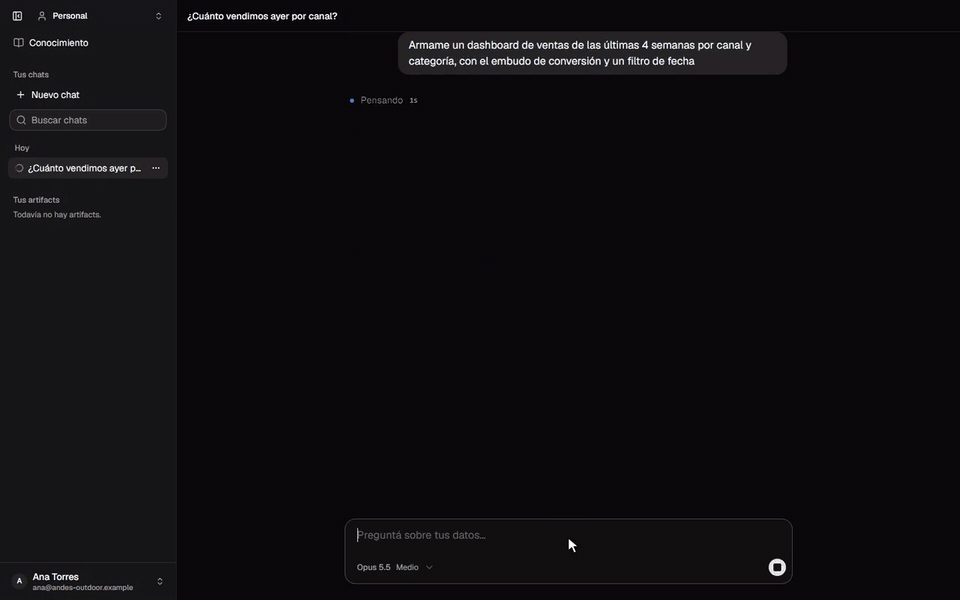
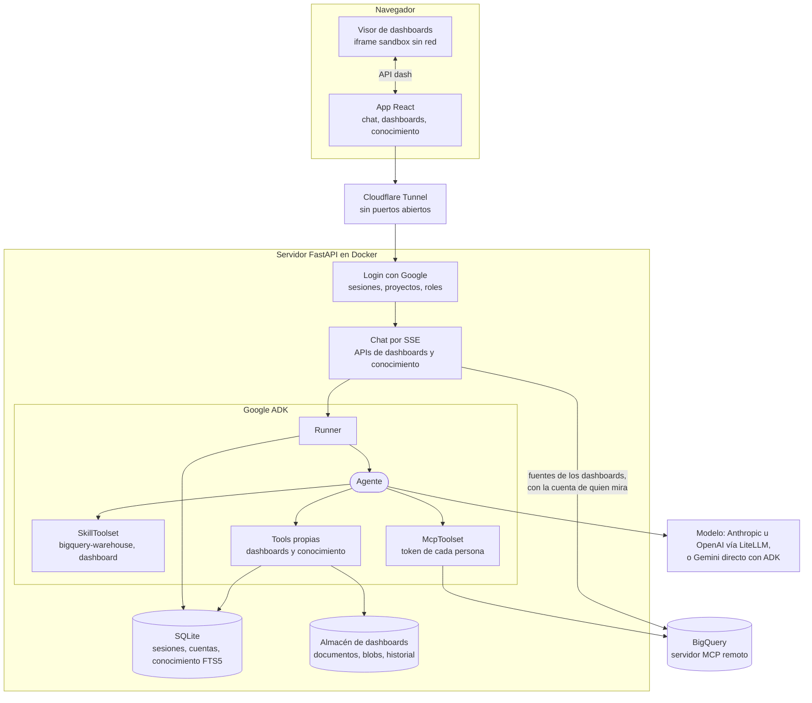
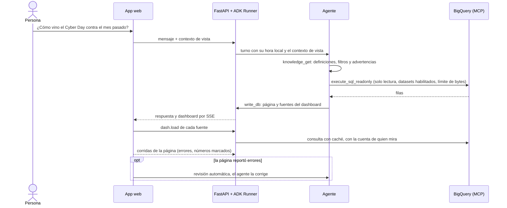

<div align="center">

# Open BI Artifacts

**Analizá tus datos de BigQuery con IA y convertí las respuestas en dashboards vivos.**<br>
Preguntás en lenguaje natural, el agente consulta con SQL de solo lectura y arma
análisis y dashboards (artifacts) que tu equipo abre, filtra y edita.

[](#instalalo-con-tu-agente-de-código)

[](https://google.github.io/adk-docs/)
[](https://cloud.google.com/bigquery/docs/use-bigquery-mcp)
[](https://modelcontextprotocol.io)
[](https://docs.litellm.ai/)

[](https://www.python.org)
[](https://fastapi.tiangolo.com)
[](https://react.dev)
[](https://www.typescriptlang.org)
[](https://vite.dev)
[](https://tailwindcss.com)
[](https://d3js.org)
[](https://www.sqlite.org/fts5.html)
[](compose.yaml)
[](https://developers.cloudflare.com/cloudflare-one/connections/connect-networks/)

[](https://github.com/dimaurizzio/open-bi-artifacts/actions/workflows/ci.yml)
[](LICENSE)

[Instalalo con tu agente](#instalalo-con-tu-agente-de-código) ·
[Qué hace](#qué-hace) ·
[Arquitectura](#arquitectura) ·
[Hecho con Google ADK](#hecho-con-google-adk) ·
[Demo](#probalo-con-datos-de-demo) ·
[Instalación](#inicio-rápido) ·
[Documentación](#documentación)

</div>

<p align="center">
  
</p>
<p align="center">
  <a href="docs/img/demo.mp4"><b>▶ Ver la demo completa (1:26)</b></a>: dos preguntas y un dashboard, con la
  <a href="docs/demo.md">tienda de demo</a>. Las esperas del modelo están aceleradas.
</p>

Se instala en tu propio servidor: tus datos no salen de tu proyecto de Google
Cloud, salvo lo que el modelo necesita ver para responder. Aprende lo que el equipo
sabe de sus datos y lo usa en cada respuesta.

<details>
<summary><b>🇬🇧 In English</b></summary>

<br>

**Open BI Artifacts** is a self-hosted AI analyst for BigQuery, built with
[Google ADK](https://google.github.io/adk-docs/). Ask questions in plain language: the
agent queries your warehouse through Google's remote BigQuery MCP server, with
read-only SQL, and turns the answers into live dashboards (artifacts) your team can
open, filter and edit.

- **Read-only by design.** Guards reject any SQL that writes, datasets that aren't
  enabled and queries that scan too many bytes. Each person can query with their own
  Google account.
- **Live dashboards.** d3 charts, filters and tables that refresh on open. Every number
  links to the query behind it, and the SQL is editable and versioned.
- **Team knowledge base.** Definitions, filter rules and caveats with authors,
  approvals and expiry. The agent reads them before picking a table, and exports them
  as an [OKF](https://okf.md) bundle.
- **Any model.** Anthropic by default, plus OpenAI or Gemini through LiteLLM or native
  ADK, selectable per message along with the reasoning effort.
- **Easy to run.** Google login, projects with roles, hardened Docker and Cloudflare
  Tunnel (no open ports).

The fastest way to install it is to hand [`AGENTS.md`](AGENTS.md) to your coding agent
(Claude Code, Codex, Gemini CLI, Cursor…): it covers setup, deployment and how to
guide your users. To do it by hand:

```bash
git clone https://github.com/dimaurizzio/open-bi-artifacts.git && cd open-bi-artifacts
python -m venv .venv && source .venv/bin/activate
pip install -e ".[dev]"
cd web && npm ci && npm run build && cd ..
cp .env.local.example .env.local   # fill in the values, see docs/configuracion.md
open-bi serve                       # http://localhost:8765
```

The UI, the docs and the agent's answers are in Spanish (Rioplatense). The agent's
language is set in its instruction (`INSTRUCTION` in `agent.py`). Contributions in
English are welcome.

</details>

## Instalalo con tu agente de código

> [!TIP]
> **No hace falta leer la documentación para empezar.** Si usás Claude Code, Codex,
> Gemini CLI, Cursor u otro agente de código, copiale el prompt de abajo. El repo trae
> [`AGENTS.md`](AGENTS.md), una guía escrita para agentes: con eso tu agente instala y
> despliega todo lo que se hace desde la terminal, y te guía en lo que tenés que hacer
> vos en Google Cloud y Cloudflare.

| 1. Copiá el prompt | 2. Respondé cuatro preguntas | 3. Listo |
| --- | --- | --- |
| Pegalo en tu agente de código, en una carpeta vacía. | Qué datos (la demo o tu warehouse), dónde (tu máquina o un servidor), qué modelo y quiénes entran. | El agente lo deja andando, verifica cada etapa y te muestra un primer recorrido. |

```text
Quiero instalar Open BI Artifacts, una plataforma open source para analizar datos y crear dashboards (artifacts) con IA sobre BigQuery: https://github.com/dimaurizzio/open-bi-artifacts

1. Cloná el repo y leé AGENTS.md: tiene el orden de lectura, las reglas y cómo verificar cada paso.
2. Antes de tocar nada, haceme las preguntas que indica AGENTS.md.
3. Instalalo y dejalo andando: hacé vos todo lo que se hace desde la terminal y, para cada paso en una consola web (Google Cloud, Cloudflare), decime exactamente dónde ir y qué completar.
4. No me pidas claves ni secretos por el chat: decime en qué archivo pegarlos.
5. Cuando funcione, guiame en un primer recorrido corto: una pregunta, un dashboard y algo que le enseñe al agente.
```

¿Preferís hacerlo a mano? Seguí el [inicio rápido](#inicio-rápido) o la guía completa de
[primeros pasos](docs/primeros-pasos.md).

## Qué hace

- **Chat sobre el warehouse.** Responde con el número, la consulta que corrió y de
  dónde sale. Solo lee: las guardas rechazan cualquier SQL que escriba, los datasets
  no habilitados y las consultas que escanean de más.
- **Dashboards en vivo.** Páginas con gráficos d3, filtros y tablas, que se
  actualizan con cada apertura. Cada número abre la consulta de la que sale
  (modo Datos), y el SQL se edita, se prueba y se versiona desde Fuentes. Si la
  página reporta errores al dibujarse, el agente los corrige solo.
- **Base de conocimiento.** Definiciones, reglas de filtro, advertencias y joins,
  con autor, aprobación y vencimiento. El agente las consulta antes de elegir una
  tabla y propone guardar lo que le enseñás, siempre con tu confirmación. Se exporta
  como bundle [OKF](https://okf.md) para leerlo en git o desde otros agentes.
- **Equipos.** Login con Google como única entrada, proyectos con roles (owner,
  editor, lector), dashboards compartidos y chats compartidos de solo lectura. Cada
  persona consulta BigQuery con su propia cuenta: ve lo que su cuenta puede leer.
- **Despliegue sin puertos abiertos.** Docker endurecido y Cloudflare Tunnel.

## Arquitectura



**Un turno, de la pregunta al dashboard:**



## Hecho con Google ADK

El agente es un solo `Agent` de [Google ADK](https://google.github.io/adk-docs/).
La plataforma lo arma con estas piezas:

| Pieza de ADK | Para qué la usa |
| --- | --- |
| `Agent` + `LiteLlm` / `Gemini` | Un agente que en cada turno usa el modelo y el esfuerzo que elige la persona en el chat (`models.py`): Anthropic, OpenAI o Gemini por LiteLLM, o Gemini directo con ADK. Un `before_model_callback` pasa la elección al pedido |
| `SkillToolset` + `load_skill_from_dir` | Skills en disco (`SKILL.md` + `references/`) que el agente carga cuando las necesita: consultas al warehouse y dashboards |
| `McpToolset` con Streamable HTTP | El servidor MCP remoto de BigQuery, solo con las herramientas de lectura. `header_provider` manda en cada llamada el token de Google de quien chatea |
| `before_model_callback` | Aplica el modelo y el esfuerzo del turno |
| `before_agent_callback` | Carga el contexto de la conversación: proyecto, datasets, nombre de la persona, índice de la base de conocimiento |
| `before_tool_callback` | Guardas SQL antes de que salga la consulta: solo lectura, datasets habilitados y dry run contra el límite de bytes |
| `after_tool_callback` | Pasa el formato f/v de BigQuery a filas legibles y recorta resultados grandes |
| Estado de sesión | Las instrucciones y las skills se interpolan con `{variables}` del estado |
| `ToolContext` | Tools propias de dashboards (`write_db`, `read_db`, `run_dataset`…) y de conocimiento (`knowledge_get`, `knowledge_propose`…) con acceso al usuario y al estado |
| `Runner` + `SqliteSessionService` | Turnos en streaming que la app sirve por SSE, e historial persistente con limpieza programada |

## Probalo con datos de demo

[docs/demo.md](docs/demo.md) crea en el sandbox gratuito de BigQuery una tienda
online ficticia (productos, clientes, pedidos, embudo web), con un Cyber Day, bots,
devoluciones y un día con pedidos duplicados para descubrir en vivo, más el
conocimiento que lo explica. Incluye ideas para grabar videos.

## Inicio rápido

Necesitás Python 3.13, Node 20 o más nuevo, el SDK de Google Cloud, un proyecto con
BigQuery (alcanza el sandbox), un cliente OAuth de Google y una clave de modelo
(Anthropic por defecto; también OpenAI o Gemini). El paso a paso completo, con el
cliente de Google y los problemas frecuentes, está en
[docs/primeros-pasos.md](docs/primeros-pasos.md).

```bash
git clone https://github.com/dimaurizzio/open-bi-artifacts.git && cd open-bi-artifacts
```

```bash
python -m venv .venv
```

Activá el entorno (`source .venv/bin/activate`, o `.venv\Scripts\activate` en
Windows) e instalá la app, que trae el comando `open-bi`:

```bash
pip install -e ".[dev]"
```

```bash
cd web && npm ci && npm run build && cd ..
```

```bash
cp .env.local.example .env.local
```

Completá `.env.local` ([todas las variables](docs/configuracion.md)), iniciá sesión en
Google Cloud y levantá la app:

```bash
gcloud auth application-default login
```

```bash
open-bi serve
```

Abrí http://localhost:8765 y entrá con tu cuenta de Google.

## Despliegue

En un VPS con Docker y Cloudflare Tunnel, sin puertos abiertos, con HTTPS, login de
Google y backups: [docs/despliegue.md](docs/despliegue.md).

## Documentación

| Para… | Leé |
| --- | --- |
| Levantar la app en tu máquina | [Primeros pasos](docs/primeros-pasos.md) |
| Probarla con datos de ejemplo | [Demo](docs/demo.md) |
| Desplegarla en un servidor | [Despliegue](docs/despliegue.md) |
| Conocer cada variable | [Configuración](docs/configuracion.md) |
| Usarla día a día | [Guía de uso](docs/guia-de-uso.md) |
| Entender cómo funciona | [Arquitectura](docs/arquitectura.md) |
| Entender la base de conocimiento | [Base de conocimiento](docs/base-de-conocimiento.md) |
| Revisar qué protege y cómo | [Modelo de seguridad](docs/seguridad.md) |
| Cambiar o extender el código | [Desarrollo](docs/desarrollo.md) |
| Instalarla con un agente de código | [AGENTS.md](AGENTS.md) |

## Estructura del código

| Ruta | Qué es |
| --- | --- |
| `agent.py` | Agente raíz: instrucciones, skills, MCP de BigQuery, callbacks |
| `models.py` | Modelo y esfuerzo por turno, de cualquier proveedor |
| `config.py` | Configuración: carga `.env.<APP_ENV>` y valida lo obligatorio |
| `skills/` | `bigquery-warehouse` (consultas) y `dashboard` (dashboards) |
| `warehouse/` | Cliente MCP, guardas SQL, credenciales por persona |
| `artifacts/` | Almacén de dashboards, validador de páginas, herramientas del agente |
| `knowledge/` | Base de conocimiento: catálogo, entradas versionadas, herramientas, exportación OKF |
| `auth/` | Login con Google, sesiones, proyectos, permisos |
| `server/` | FastAPI: chat (SSE), APIs, visor de dashboards, backups, limpieza |
| `web/` | Front: React + TypeScript + Vite, assistant-ui, shadcn/ui, Tailwind v4 |
| `demo/` | Dataset y conocimiento de demo |
| `tests/` | Tests del backend |

## Tests

```bash
pytest
```

```bash
cd web && npm run typecheck
```

## Contribuir

Issues y pull requests son bienvenidos: ver [CONTRIBUTING.md](CONTRIBUTING.md). Para
reportar una vulnerabilidad, [SECURITY.md](SECURITY.md).

## Licencia

[Apache 2.0](LICENSE).
