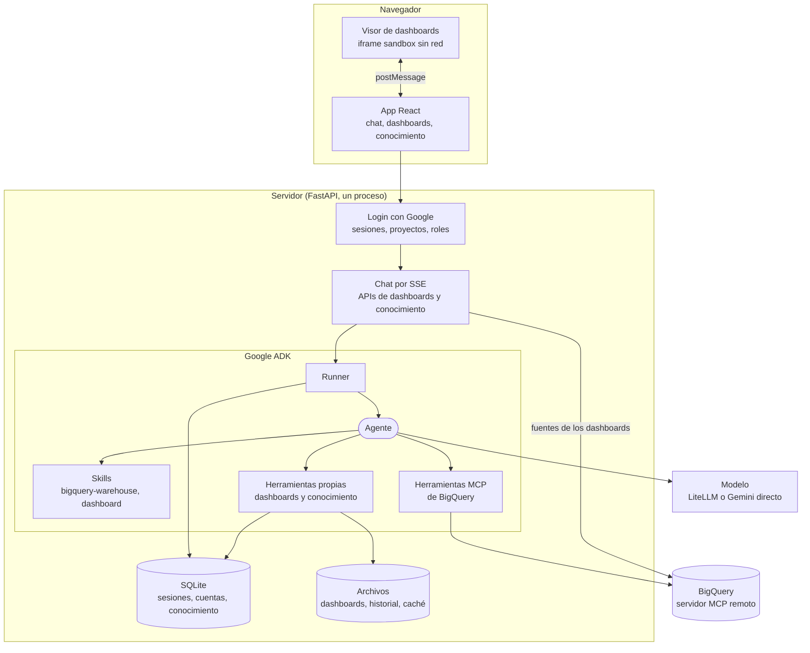
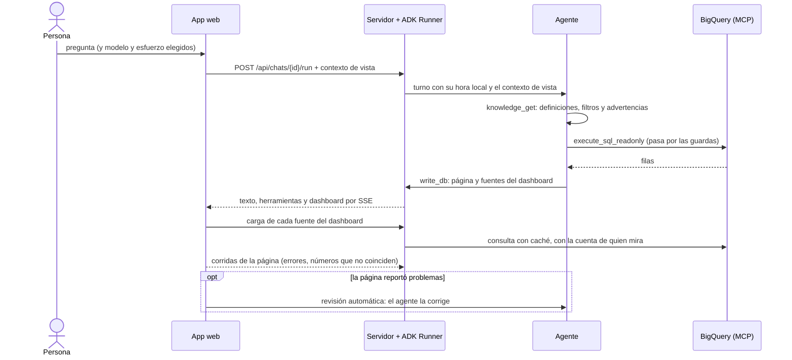

# Arquitectura

Open BI Artifacts es un servidor FastAPI que sirve una app React y corre un agente de
[Google ADK](https://google.github.io/adk-docs/). El agente consulta BigQuery por el
servidor MCP remoto de Google, arma dashboards que la app muestra en un visor aislado y
usa una base de conocimiento propia para responder con las definiciones del equipo.

## Vista general

| Pieza | Qué hace | Dónde |
| --- | --- | --- |
| Agente | Un solo agente de ADK con instrucciones, skills, herramientas y callbacks | `agent.py` |
| Modelos | Modelo y esfuerzo elegidos en cada turno, de cualquier proveedor | `models.py` |
| Warehouse | Cliente MCP de BigQuery, guardas SQL, credenciales por persona | `warehouse/` |
| Dashboards | Almacén de documentos, validador de páginas, herramientas del agente | `artifacts/` |
| Conocimiento | Catálogo, entradas versionadas, herramientas, exportación OKF | `knowledge/` |
| Cuentas | Login con Google, sesiones, proyectos, permisos | `auth/` |
| Servidor | FastAPI: chat, APIs, visor, retención, backups | `server/` |
| App | React + TypeScript + Vite, assistant-ui, shadcn/ui, Tailwind | `web/` |
| Configuración | Carga `.env.<APP_ENV>` y valida lo obligatorio al arrancar | `config.py` |

## Un turno, de la pregunta al dashboard

1. **El mensaje llega con contexto.** El navegador manda la hora local de la persona,
   el modelo y el esfuerzo elegidos y, si hay un dashboard abierto, dónde está mirando
   (pestaña, filtros, número seleccionado). La hora y el contexto de vista viajan
   delante del mensaje, en bloques que el chat no muestra.
2. **El turno corre en el servidor, no en la conexión.** Cada turno es una tarea propia
   (`server/runs.py`). Cambiar de chat, recargar o cerrar la pestaña no lo corta: al
   volver, la app se reengancha y lo repite desde el mensaje de la persona. Solo
   "Detener" lo cancela. Un chat tiene un turno a la vez.
3. **El agente prepara el turno.** Un `before_agent_callback` carga en el estado de la
   sesión el proyecto y los datasets habilitados, el nombre de la persona y un índice
   corto de lo documentado en la base de conocimiento. Las instrucciones y las skills
   se completan con esas variables, que no cambian de un turno a otro.
4. **Consulta con guardas.** Antes de que una consulta salga, un `before_tool_callback`
   la valida: solo lectura, solo datasets habilitados y un dry run contra el límite de
   bytes. Después, un `after_tool_callback` pasa el resultado de BigQuery a filas
   legibles y recorta lo que sobra.
5. **El dashboard se escribe como documentos.** El agente no genera un HTML suelto:
   escribe documentos (página, fuentes, filtros) que el servidor valida antes de
   guardar. La app los muestra en el visor.
6. **La página se verifica sola.** El visor compara cada número marcado con los datos de
   su fuente y anota los errores en un documento de corridas. Si el agente acaba de
   escribir la página y aparecen problemas, la app le pide que los corrija.

## El agente

Un solo agente, sin sub-agentes. Lo que cambia de un turno a otro es el modelo, las
skills cargadas y el estado.

| Pieza de ADK | Para qué |
| --- | --- |
| `Agent` | Instrucciones con ejemplos, skills y herramientas |
| `SkillToolset` | Carga progresiva de skills: el catálogo va en el prompt; las instrucciones y referencias, cuando hacen falta |
| `McpToolset` | Herramientas de lectura del servidor MCP de BigQuery; `header_provider` manda el token de quien chatea |
| `before_agent_callback` | Contexto del turno (warehouse, persona, índice de conocimiento) |
| `before_model_callback` | Modelo y esfuerzo del turno |
| `before_tool_callback` | Guardas SQL |
| `after_tool_callback` | Resultados de BigQuery legibles y acotados |
| `ToolContext` | Herramientas propias con acceso a la persona y al estado |
| `Runner` + `SqliteSessionService` | Turnos en streaming e historial persistente |

### Skills

Las skills viven en `skills/` y se cargan con `load_skill_from_dir`. Son texto para el
agente, sin valores fijos: el proyecto, los datasets y los límites llegan por el estado.

| Skill | Para qué | Herramientas que usa |
| --- | --- | --- |
| `bigquery-warehouse` | Explorar el warehouse y responder con SQL | Las de BigQuery y las de conocimiento |
| `dashboard` | Armar y cambiar dashboards | `create_dashboard`, `write_db`, `read_db`, `upload_asset`, `delete_asset`, `run_dataset`, `list_dashboards` |

### Un prompt que no cambia

El prompt de sistema y la lista de herramientas son los mismos en toda la
conversación. Lo que cambia en cada turno (la hora local de la persona, el contexto de
vista) viaja delante del mensaje, en bloques `<turn-context>` y `<view-context>` que el
chat no muestra. Hay dos razones:

- **Razonamiento preservado.** Los modelos que atan su razonamiento al prompt (como los
  5.5 de Anthropic) rechazan el historial si el prompt de sistema o las herramientas
  cambiaron desde que lo generaron.
- **Caché de prompts.** Un prefijo estable se reutiliza de un turno al otro.

Por eso las herramientas de dashboards están declaradas desde el primer turno. Lo que
antes se lograba activándolas con la skill, que el agente lea las reglas antes de
escribir, lo garantiza una guarda: `create_dashboard`, `write_db`, `upload_asset` y
`delete_asset` se rechazan hasta que el agente carga la skill `dashboard`.

### Modelos

La persona elige modelo y esfuerzo en el chat. El catálogo sale de `AGENT_MODELS` y
cada modelo ofrece solo los niveles de esfuerzo que soporta, según el mapa de modelos
de LiteLLM.

- **Por LiteLLM** (`anthropic/…`, `openai/…`, `gemini/…`): el esfuerzo va como
  `reasoning_effort` y LiteLLM lo traduce a cada API.
- **Gemini directo con ADK** (nombre sin proveedor, como `gemini-3.8-flash`): el
  esfuerzo va como `thinking_config.thinking_level`.

`TurnModel` hereda de `LiteLlm` para que ADK conserve los ids de las llamadas a
herramientas, que Anthropic y OpenAI necesitan, y delega cada pedido en el backend del
modelo elegido. Cambiar de modelo o de esfuerzo en medio de un chat funciona, pero ese
turno no aprovecha la caché de prompts.

## Warehouse

El agente y los dashboards hablan con el
[servidor MCP remoto de BigQuery](https://cloud.google.com/bigquery/docs/use-bigquery-mcp).
El agente solo tiene las herramientas de lectura: `list_dataset_ids`,
`get_dataset_info`, `list_table_ids`, `get_table_info`, `execute_sql_readonly` y
`get_query_results`.

| Guarda | Cómo |
| --- | --- |
| Solo lectura y una sentencia | Análisis del SQL antes de cada consulta (`warehouse/sql_guard.py`) |
| Solo datasets habilitados (`WAREHOUSE_DATASETS`) | Análisis de las tablas que nombra la consulta |
| Límite de bytes (`MAX_BYTES_SCANNED`) | Dry run antes de correr |
| Filas que ve el modelo (`AGENT_MAX_ROWS`) | El resultado se recorta antes de volver al agente |
| Parámetros de los filtros | Se insertan como un literal tipado, nunca como texto suelto |

Las guardas valen igual para el agente y para las fuentes de los dashboards. Los
permisos de IAM de BigQuery siguen siendo la última barrera: ver
[seguridad.md](seguridad.md).

### Credenciales

- `QUERY_CREDENTIALS=reader` (default): cada persona consulta con su propia cuenta de
  Google. Al entrar se pide el permiso de BigQuery; el refresh token se guarda cifrado.
  La caché de los dashboards es por persona.
- `QUERY_CREDENTIALS=server`: todos consultan con la cuenta del servidor.

La cuenta del servidor se usa siempre para sincronizar el catálogo, generar las
sugerencias y validar el SQL de la base de conocimiento.

## Dashboards

Un dashboard es un almacén de documentos y un visor fijo que los interpreta.

| Documento | Qué guarda |
| --- | --- |
| `dash/meta` | Título, descripción, proyecto |
| `dash/params` | Filtros y sus valores por defecto |
| `datasets/<id>` | Cada fuente: una llamada MCP serializada (`execute_sql_readonly` con su SQL) o un archivo subido |
| `files/*` | La página: HTML, CSS y JS |
| `data/users/<persona>/runs` | Lo que vio cada lector: errores, números que no coinciden, fuentes que fallaron |

Todo vive en `data/artifacts/<id>/`, con historial de versiones de cada documento y
caché de resultados.

### Cómo corre una página

1. `/viewer/<id>` sirve el HTML con una CSP estricta, d3 v7 y el runtime del visor, en
   un `<iframe sandbox>` sin `allow-same-origin` y sin red.
2. El runtime monta la página y descarta lo que no debe estar: iframes, formularios,
   `<meta>`, `<base>`, atributos `on…=`, URLs externas.
3. Los scripts de la página reciben la API `dash` y d3. Los datos llegan solo por
   `dash`: la página pide una fuente, la app la carga por la API del servidor y se la
   pasa por `postMessage`.
4. Cada número marcado con `data-source` se compara con su fuente. Los errores y las
   discrepancias se guardan en el documento de corridas de quien mira.

### Fuentes y caché

| Tipo | Quién consulta | Cuándo se actualiza |
| --- | --- | --- |
| Consulta en vivo | El servidor, a pedido del visor | Al abrir (si venció la caché de `DEFAULT_TTL_SECONDS`), al filtrar o con "Refrescar" |
| Resultado guardado | El agente | Cuando se lo piden |
| Archivo | Nadie: lo sube la persona | Subiendo otra versión |

Los filtros vuelven a correr solo las fuentes que los usan. Desde el panel Fuentes, un
editor puede cambiar el SQL de una fuente, probarlo, guardarlo y volver a una versión
anterior.

## Base de conocimiento

Una base SQLite propia con tres capas que no se mezclan: el catálogo de BigQuery, el
conocimiento compartido (con autor y aprobación) y las notas privadas de cada persona.
El agente recibe un índice corto y lee el detalle con herramientas. Lo aprobado se
exporta como bundle [OKF](https://okf.md). Detalle en
[base-de-conocimiento.md](base-de-conocimiento.md).

## Cuentas y permisos

Se entra solo con Google (OpenID Connect con PKCE). Los dashboards son personales o
de un proyecto con roles owner, editor y viewer. Los permisos se fuerzan en el
servicio de dashboards, así que valen igual para la API, el visor y las herramientas
del agente. Detalle en [seguridad.md](seguridad.md) y en la
[guía de uso](guia-de-uso.md#proyectos-y-permisos).

## La app

- **Chat:** [assistant-ui](https://www.assistant-ui.com/) con un store propio
  (`web/src/lib/store.ts`, zustand) por `ExternalStoreRuntime`. Cada evento del SSE se
  convierte en partes del mensaje: texto, llamadas a herramientas con su resultado y
  la tarjeta del dashboard.
- **Componentes:** los de assistant-ui y shadcn/ui se copian al repo (modelo
  registry) y están en español: `web/src/components/assistant-ui/` y
  `web/src/components/ui/`.
- **Paneles:** barra lateral, chat y panel derecho (dashboard o conocimiento),
  redimensionables. En celular, la barra es un panel deslizable.
- **Herramientas con vista propia:** las consultas muestran el SQL, los bytes y las
  filas; los borradores de conocimiento muestran cómo quedaría la entrada.

## Datos en disco

Todo lo que la app guarda está en `DATA_DIR` (`/data` en Docker):

| Ruta | Qué |
| --- | --- |
| `sessions.db` | Chats (sesiones y eventos de ADK) |
| `app.db` | Cuentas, sesiones de login, proyectos, chats compartidos, tokens de Google cifrados |
| `knowledge.db` | Catálogo y base de conocimiento |
| `artifacts/` | Dashboards: documentos, archivos, historial y caché |
| `feedback.jsonl` | 👍 y 👎 de las respuestas |
| `secret_key` | Clave generada en local cuando `SECRET_KEY` está vacía |

`server/backup.py` copia todo en caliente. Ver [despliegue.md](despliegue.md#operación).

## Límites conocidos

- **Un proceso.** Los turnos en curso viven en memoria y las bases son SQLite: alcanza
  para un equipo. Para varios workers hacen falta un broker para los turnos y Postgres.
- **Dashboards nuevos en el espacio personal.** El agente crea los dashboards a nombre
  de quien chatea; se mueven a un proyecto desde la app.
- **Refrescos programados y exportación.** Todavía no hay: los resultados guardados se
  refrescan pidiéndoselo al agente.
